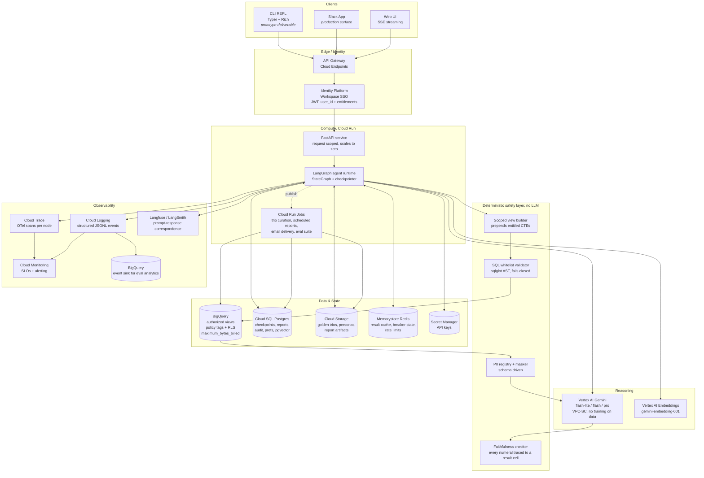
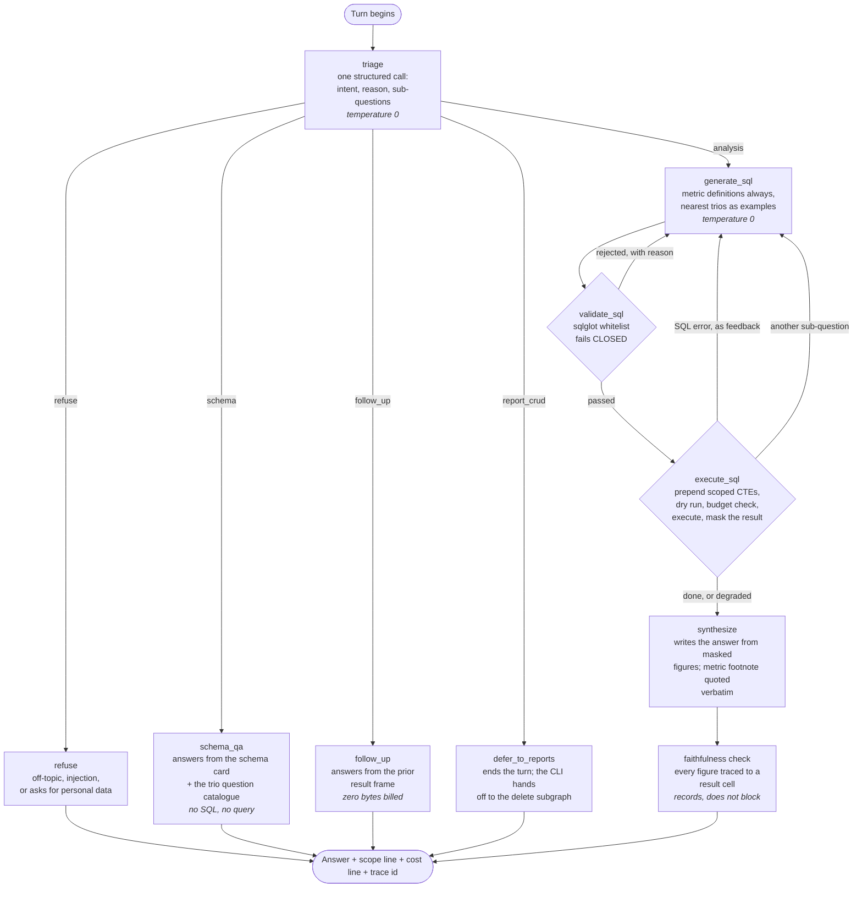
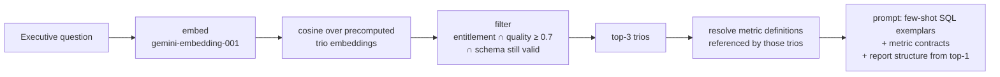
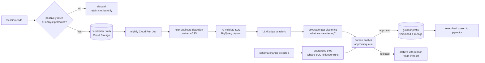
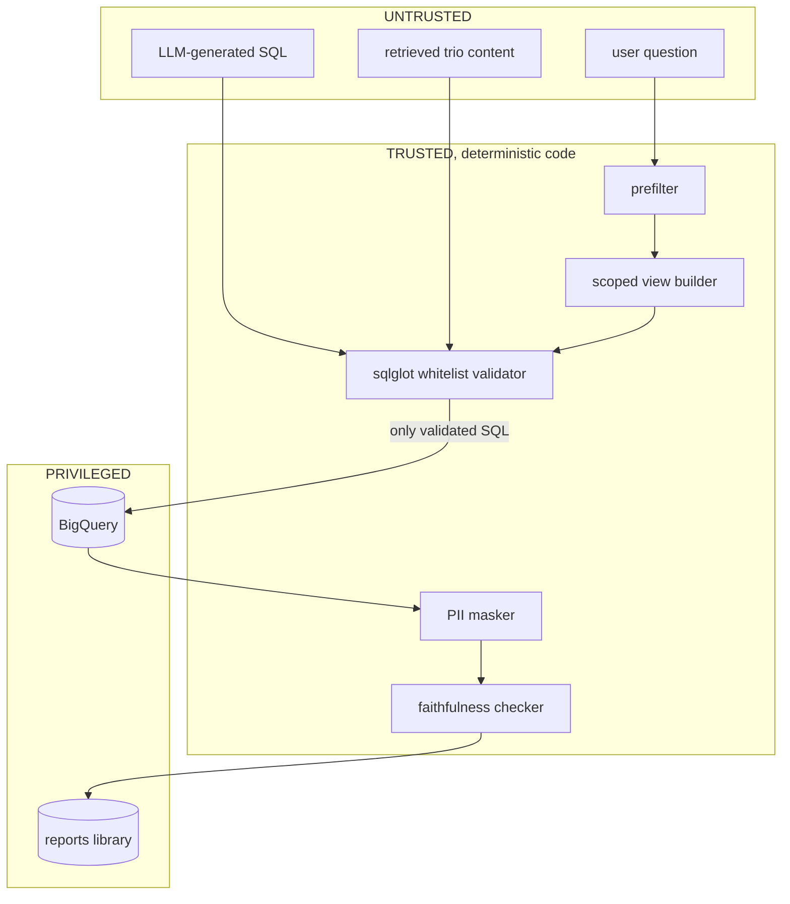
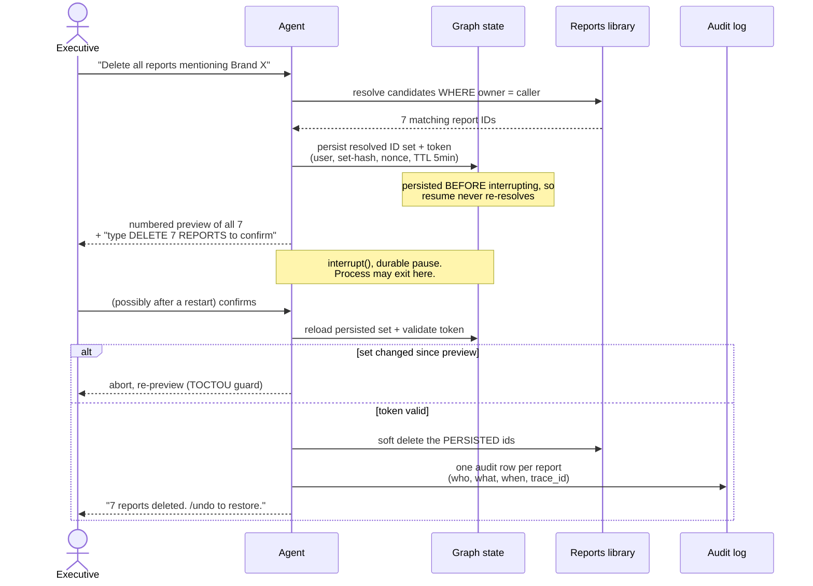
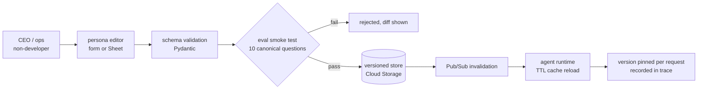

# High-Level Design, Executive Data Analysis Agent

**Client:** OpsFleet (retail company engagement)
**Audience:** non-technical executives asking analytical questions in natural language
**Data:** `bigquery-public-data.thelook_ecommerce`, `orders`, `order_items`, `products`, `users`

This document is the production design. Where the prototype differs, the difference is stated
explicitly rather than glossed, see [§11 Prototype vs production](#11-prototype-vs-production).

---

## 1. The problem, stated precisely

An executive asks *"Why are users in Texas underspending versus California?"* The system must
turn that into correct SQL, execute it safely, interpret the result the way a human analyst
would, and present it without leaking personal data, then let the executive argue with the
answer, save it, and later delete it.

Three properties make this harder than "text-to-SQL with a chat wrapper":

1. **The questions are multi-step and conversational.** Every example in the brief decomposes
   into several queries, and the follow-up ("why is that?") carries context.
2. **The audience cannot sanity-check the number.** A technical user notices when revenue looks
   wrong by a factor of three. An executive acts on it. The dominant risk is therefore not a
   failed query but a confidently wrong answer.
3. **The data is sensitive and the user is partially entitled.** Safety is not a filter applied
   at the end; it has to be a property of the query itself.

### The trap in this dataset

There is no revenue column. Revenue must be derived from `order_items.sale_price`, and
*both* `orders.status` and `order_items.status` carry `Cancelled` and `Returned`. So "total
revenue" has several plausible-looking definitions and a language model will silently pick
one. Measured on the full dataset: including cancelled and returned orders gives
$10,814,271 of revenue, excluding them gives $8,148,817. Picking the wrong one
overstates revenue by 32.7%.

(The two status columns turn out to hold identical values in all 181,978 rows, so
choosing between them is harmless here. Whether to filter on them at all is not.)

This single observation drives the central design decision: the Golden Bucket is not decorative
RAG, it is the mechanism that pins metric definitions down. See §6.

---

## 2. Design principles

These are the rules that resolve every later trade-off.

| # | Principle | Consequence |
|---|---|---|
| P1 | **Validators, not rewriters** | A rewrite that misses a case fails *open*. A validator that misses a case fails *closed*. Security controls are expressed as rejection, never as mutation. |
| P2 | **Safety is structural, not instructional** | PII columns are absent from the queryable surface, rather than present-but-forbidden by prompt. A prompt-injection cannot talk its way past a column that does not exist in the view. |
| P3 | **Determinism wherever correctness matters** | The SQL gate, entitlement scoping, PII masking and report faithfulness checks use no LLM. Cheaper, faster, testable, and not susceptible to persuasion. |
| P4 | **The LLM proposes; code decides** | No irreversible action is parameterised by a model at execution time. Deletion runs against a previously previewed, persisted ID set. |
| P5 | **Degradation announces itself** | Every fallback is labelled in the response. A stale or partial answer that looks complete is worse than an error. |
| P6 | **Bounded everything** | Retries, plan steps, tokens, bytes billed and wall-clock all have ceilings held in state. An agent that cannot bound itself cannot be costed. |
| P7 | **Config over code for anything a human changes weekly** | Personas, model IDs and entitlements are versioned data, so changing them is not a deployment. |

---

## 3. System architecture

Building blocks, services and compute. Prototype substitutions appear in §11.



### Why this shape

**Cloud Run, not GKE or Functions.** The workload is bursty, request-scoped, and idle most of
the day, a handful of executives, not a consumer product. Cloud Run scales to zero (no idle
cost), has no cluster to operate, and its 60-minute request ceiling comfortably covers a
multi-step report. Cloud Functions would be too constrained for a long streaming response;
GKE would mean operating a cluster for single-digit concurrent users.

**Vertex AI Gemini in production, AI Studio in the prototype.** The assignment asks for Gemini.
Vertex adds what production requires and AI Studio lacks: VPC Service Controls, data residency,
contractual no-training-on-data, provisioned throughput instead of shared rate limits, and IAM
rather than a bearer key. The prototype uses an AI Studio key because it is free and
zero-setup, a deliberate, stated trade.

**Separate Cloud Run Jobs for async work.** Golden Bucket curation, scheduled digests, email
delivery and the eval suite are long-running and must not share the request path. Triggering via
Pub/Sub means the agent fires and forgets; a slow report cannot hold a user's turn open.

**Cloud SQL Postgres as the one relational store.** It serves four needs, LangGraph
checkpoints, the saved-reports library, the audit log, and (via `pgvector`) trio embeddings.
One store with transactional integrity beats four specialised ones at this scale; the audit log
in particular wants the same transaction as the delete it records.

**pgvector, not Vertex Vector Search.** The Golden Bucket is 10²–10³ documents. A managed vector
service is built for 10⁶+ and its cost floor and operational surface are unjustified here.
Knowing when *not* to reach for infrastructure is part of the design. The upgrade path is a
single retriever interface swap, named in §6.

**Redis for ephemeral cross-instance state.** Circuit-breaker state, rate-limit counters and the
query result cache must be shared across Cloud Run instances, and all three are fine to lose on
restart. That is exactly Redis's remit and not Postgres's.

---

## 4. The agent graph

This is the graph as built, node for node. Where the prototype folds a step into
another node rather than giving it its own, that is noted after the diagram.



Folded in rather than separate nodes, to keep the graph small:

| Design step | Where it actually lives |
|---|---|
| `mask_pii` | inside `execute_sql`, before the frame is stored, so masking still precedes synthesis |
| `repair_sql` | a conditional edge back to `generate_sql` carrying the error as feedback, bounded by the budget's must-change-hash guard |
| `diagnose_empty` | inside `synthesize`, which reports no-rows as its own outcome rather than a zero |
| `retrieve_golden_trios` | before the graph, in the CLI, so the retrieved context arrives as an input |
| deterministic prefilter | not built. Triage handles classification and refusal in one call; a regex prefilter would save a call on obvious abuse and is the first thing to add |
| `learn_prefs` | not built. Style is an explicit per-user setting, not learned. See §13 |

### Three routes a naive design omits

A one-SQL-per-turn graph fails requirements the brief states verbatim:

- `schema_qa`: *"Answer questions about the general structure of the database (what data is
  available, what can we do with it)"*. Answered from a cached schema card with no query at all.
  "What can we do with it" is answered by surfacing the Golden Bucket's question catalog, which
  turns requirement 1 into onboarding.
- `follow_up`: *"discuss about it"*. "Why is that?" / "break that down by state" must read
  the previous result frame from state rather than re-querying. This is also the cheapest path in
  the system: zero bytes billed, which serves requirement 5's cost clause.
- The multi-step loop: *every* example question in the brief decomposes ("state X vs state
  Y" is at minimum two aggregates plus a comparison; "Q1 report with Q2 action items" is several).
  Capped at three steps by the budget in state.

### Why fused `triage` rather than separate classify and guard nodes

Two LLM calls before any work begins is poor economics on a rate-limited tier, and ordering
matters: the *deterministic* prefilter runs first, so an obvious injection costs nothing. Intent
classification, scope checking and plan decomposition then share one structured-output call.
Fewer nodes, a clearer diagram, and roughly two fewer calls per turn once repair loops and
multi-step plans multiply.

---

## 5. Framework choice: LangGraph

**All four mandated requirements are control-flow problems**, and LangGraph makes control flow
explicit rather than emergent.

| Requirement | Control-flow need | Primitive |
|---|---|---|
| High-stakes oversight | durable pause mid-execution surviving process restart | `interrupt()` + checkpointer |
| Resilience | a **bounded** cycle, a free-running loop inflates cost without limit | conditional edge + counter in state |
| Observability | per-step attribution of latency, tokens, cost, failure | one event per node, from the topology |
| Extensibility | add a capability without touching the core | new node/subgraph + edge |

**The honest counter-argument:** a single Gemini function-calling loop would be ~200 lines and
perfectly adequate for a demo. LangGraph is chosen because the brief asks for *production-ready*,
and an LLM-driven loop cannot bound its own retries, cannot durably pause for human approval, and
cannot report which step failed. Those three are exactly the graded requirements.

**Rejected: Google ADK.** A compelling all-Google story and tight Vertex/BigQuery integration,
but it abstracts the interrupt and retry semantics that this assignment is specifically testing,
and learning it inside a time-box would trade control for novelty.

**Experience level, stated plainly:** production LangGraph/LangChain experience, including
checkpointed state and human-in-the-loop interrupts. The version-specific semantics that bite,
node re-execution on resume, positional resume matching, `durability="sync"`, were verified
against the installed source rather than assumed, and are documented in
[`DECISIONS.md`](DECISIONS.md).

---

## 6. Hybrid intelligence: the Golden Bucket

### What a trio is

```json
{
  "id": "trio_0017",
  "question": "Why is revenue down in Women's Apparel this quarter?",
  "sql": "WITH ...",
  "report": "Revenue fell 12.4% QoQ, driven by ...",
  "metadata": {
    "tables": ["order_items", "products", "orders"],
    "metrics": ["net_revenue", "aov", "return_rate"],
    "grain": "category x month",
    "author": "analyst@retail.com",
    "approved_at": "2026-08-14",
    "quality_score": 0.91,
    "tags": ["revenue", "decline", "category"]
  }
}
```

### The part that actually matters: the mined metric layer

Retrieving similar questions improves phrasing. What prevents *wrong numbers* is the **metric
registry mined from the trios**, the definitions human analysts actually used:

```yaml
net_revenue:
  sql: SUM(oi.sale_price)
  requires: [order_items oi, orders o]
  filter: o.status NOT IN ('Cancelled', 'Returned')
  note: gross_revenue omits the status filter, which overstates revenue by 32.7%
  source_trios: [trio_0017, trio_0023, trio_0031]
```

Recall §1: with no revenue column and `Cancelled`/`Returned` on two different tables, a model
free-hands this differently each time. The registry makes "revenue" mean one thing, cites the
trios it came from, and lets the report footnote its own definition. **This is what makes
requirement 1 load-bearing rather than decorative.**

### Retrieval at query time



Embeddings are precomputed at build time, so query-time cost is one embedding call for the
question, not 30 for the corpus.

**Right-sizing, stated for the record:** at ~40 trios, putting a compact catalog of trio
*questions* in one prompt and letting the model select by ID would work about as well. Embeddings
are chosen for the scaling path, behind a retriever interface whose production implementation is
`pgvector`. Reaching for FAISS or a managed vector DB at this corpus size would be the wrong
instinct.

### Updating the bucket over time



**The poisoning risk, which is the real question being asked.** Auto-promoting answers that
users accepted teaches the system its own mistakes: a plausible-but-wrong revenue definition gets
accepted once, becomes a retrieved exemplar, and propagates. Mitigations: human approval before a
trio becomes retrievable; an offline eval gate; `quality_score` decay for trios that stop
correlating with positive outcomes; full lineage so one rollback removes a bad trio and
everything derived from it.

---

## 7. Safety model

### Trust boundaries



**Everything a model produces is untrusted input to a deterministic gate.** That includes
retrieved trio content, a poisoned trio must not be able to smuggle SQL past the validator.

### Layer 1: entitlement scoping (structural)

The system prepends generated CTEs; it does not rewrite the model's SQL:

```sql
WITH s_products AS (
  SELECT id, category, brand, department, retail_price, cost, name
  FROM `bigquery-public-data.thelook_ecommerce.products`
  WHERE category IN ('Women''s Apparel', 'Accessories')   -- caller's entitlements
),
s_order_items AS (
  SELECT oi.* FROM `bigquery-public-data.thelook_ecommerce.order_items` oi
  JOIN s_products p ON p.id = oi.product_id                -- scope enforced by the join
),
s_users AS (
  SELECT id, age, gender, state, city, country, traffic_source, created_at
  FROM `bigquery-public-data.thelook_ecommerce.users`      -- PII columns simply absent
)
-- model-authored SQL may reference ONLY s_products, s_order_items, s_orders, s_users
```

**Why prepend rather than rewrite.** An earlier design filtered references to `products`. It had
a bypass: `SELECT SUM(sale_price) FROM order_items` mentions no `products`, so no filter fires and
the caller sees company-wide revenue, and since `order_items.sale_price` is the only revenue
column, that is the *common* question shape. Prepending plus whitelisting inverts the failure
mode: anything the validator cannot fully account for is rejected (P1).

This also makes PII structural (P2): `email` is not forbidden, it is *absent*. And it
collapses two requirements into one mechanism, which is less code than the rewrite.

### Layer 2: the whitelist validator

`sqlglot`, BigQuery dialect, deterministic, zero LLM cost. Rejects: more than one statement; any
node that is not `SELECT`/`WITH`; any DML or DDL; `EXECUTE IMMEDIATE` and scripting;
`EXTERNAL_QUERY`; any table identifier outside the four scoped names; any fully-qualified
reference to `bigquery-public-data`; any CTE shadowing a scoped name; a missing `LIMIT`.
**Unparseable SQL is rejected, never waved through.**

### Layer 3: masking before synthesis

Two orderings matter more than the rules:

1. **`mask_pii` precedes `synthesize_report`.** Raw PII never enters the model context. Masking
   at print time silently exfiltrates PII to the LLM, the common mistake.
2. **The question and generated SQL are scrubbed before logging**, or a `WHERE email = ...`
   predicate lands in the event log and traces.

A narrow email/phone regex sits at egress as a tripwire, not a filter. It should never fire;
a firing is a defect in an upstream layer and pages accordingly (§9).

### Layer 4: identity disclosure, not inference

Requirement 2 forbids *displaying* PII. The brief *also* requires "top customers", which is
inherently per-individual. A blanket k-anonymity floor would fail a named capability, so:
direct identifiers are unprojectable; ranking is answerable via a stable pseudonym
(`CUST-3f9a2b`). k-anonymity is applied narrowly to demographic cross-tabs on quasi-identifiers,
not globally. Reasoning in [`ASSUMPTIONS.md` A5](ASSUMPTIONS.md).

### Production hardening beyond the prototype

Authorized views with the agent's service account holding no base-table grant; row-level
access policies keyed on `SESSION_USER()`; column-level policy tags with dynamic masking.
Note that RLS is *impossible* in the prototype by construction, it requires table ownership,
and `bigquery-public-data` is read-only to us. The scoped-CTE design is the faithful stand-in,
which is why it was chosen to mirror the production shape.

---

## 8. High-stakes oversight



**The decision a model must never make (P4).** Deletion executes against the *previewed,
persisted* ID set, passed as data to deterministic code, never as a tool call the model can
re-parameterise after confirmation. An owner predicate at the data-access layer is defence in
depth. Without this, "delete the ones I said" is re-interpreted post-approval, which is the
central failure mode of agentic destructive actions.

**Friction scales with blast radius**, the "without breaking UX" clause. One or two reports: a
natural "yes" is enough. Bulk or "all": a typed token. Uniform maximum friction trains users to
confirm reflexively, which defeats the control.

**Both named shapes are supported:** content match ("mentioning Client X") and session scope
("the reports we made in this conversation", resolved by thread provenance stored on every
report). Soft delete with `/undo`; the audit log is append-only and retains the event even after
content erasure.

---

## 9. Observability

**One owned source of truth.** A structured JSONL event stream, one record per node execution,
correlated by `trace_id`. It is greppable, ships in the repo as an artifact, powers `/trace`, and
depends on nothing external, a *mandated* requirement must not rest on a third-party SaaS.
LangSmith/Langfuse is one optional env var for prompt-response correspondence; OTel to Cloud
Trace is the production exporter.

Every event: `trace_id`, `turn_id`, `node`, `status`, `latency_ms`, `model`, `tokens_in/out`,
`cost_usd`, `bytes_billed`, `retry_count`, `error_class`, `persona_version`, `user_id`.
Prompts are stored post-scrub (§7).

### Metrics, thresholds and actions

| Family | Metric | Threshold | Action |
|---|---|---|---|
| **Safety** | PII tripwire firings | **any** | page immediately, an upstream layer leaked |
| | entitlement-violation attempts | spike vs. baseline | security review |
| | injection detections | tracked | tune prefilter |
| | validator rejection rate | > 15% | SQL prompt or scoped views need work |
| **Quality** | SQL valid on first try | < 80% | review few-shot exemplars |
| | repair success rate | < 50% | repair prompt ineffective |
| | faithfulness-check failures | **any** | investigate, fabricated numbers |
| | empty-result rate | > 10% | question-understanding gap |
| | false-refusal rate | > 2% | prefilter too aggressive |
| **Cost** | LLM calls per turn | p95 > 4 | plan/repair loops leaking |
| | bytes billed per user per day | > quota × 0.8 | alert, then throttle |
| | cache hit rate | < 30% | cache key too specific |
| **Reliability** | node error rate by class | > 1% | triage by `error_class` |
| | circuit-breaker state | open | dependency incident |
| | `GraphRecursionError` count | any | loop bound breached |
| **UX** | task success rate | < 85% | the headline SLO |
| | turns to answer | p50 > 3 | clarification friction |
| | **confirmation abandonment** | > 20% | previews unclear or over-friction |
| | time to first token | p95 > 4s | perceived latency |

**Deep-dive path.** Every user-facing error quotes its `trace_id`. `/debug` prints the last
turn's node-by-node timeline with scrubbed prompts and the SQL at each repair attempt; `/trace
<id>` replays any stored turn. In production, events land in BigQuery so failure clustering and
eval-set construction are SQL queries rather than a bespoke tool.

---

## 10. Resilience and failure handling

| Failure | Detection | Response | User sees |
|---|---|---|---|
| SQL syntax/semantic error | BigQuery error | repair node, max 2, must-change-hash | transparent unless exhausted |
| Repair exhausted | attempt counter | stop, surface the SQL | explanation + `trace_id` + the SQL for a human |
| **Empty result** | row count 0 | **diagnose**: probe date bounds, widen filters | *"No rows, this category has no orders after 2024-06"*, never a fabricated zero |
| Validator rejection | AST gate | one regeneration with the violation as feedback, then refuse | explanation of the constraint |
| Gemini 429 | status + `retry-after` | honour `retry-after`, backoff with jitter, then fall back a model tier | *"using a faster model, quality may vary"* |
| Gemini / BigQuery outage | circuit breaker opens | serve cached result if present | *"answered from cache, 38 minutes old"* (**P5**) |
| Embedding service down | timeout | degrade to schema-only SQL generation | *"historical analyst examples unavailable this turn"* |
| Budget ceiling hit | in-state counters | stop cleanly | partial findings + what was skipped and why |
| Recursion limit | `GraphRecursionError` | caught as graceful degradation | explanation + `trace_id` |
| Anything unhandled | per-turn exception boundary | log, return message, **state preserved** | the CLI never crashes; conversation survives |

**Cost containment (P6)**, because *"without inflating costs"* is a graded clause:
≤3 LLM calls per turn by design; deterministic gates use no LLM at all; follow-ups answered from
the prior result frame cost zero bytes; `dry_run` + `maximum_bytes_billed` before every execute;
repair capped with a must-change-hash guard so a model cannot resubmit identical failing SQL;
schema and results cached. The CLI prints a cost line each turn (bytes billed, tokens, cache
hit) so this is observable rather than merely claimed.

**Demonstrable, not just implemented:** `--chaos bq_fail|llm_429|embed_fail` injects faults so
graceful degradation can be seen in ten seconds. A reviewer should not have to take resilience on
faith.

---

## 11. Prototype vs production

| Concern | Prototype | Production | Why the substitution is sound |
|---|---|---|---|
| Interface | CLI (Typer + Rich) | Slack + web, SSE | CLI is the mandated deliverable; the graph is surface-agnostic |
| Compute | local process | Cloud Run | the graph is identical; only the entry point differs |
| LLM | AI Studio key | Vertex AI Gemini | same models; Vertex adds VPC-SC, residency, provisioned throughput |
| Entitlements | scoped CTEs + whitelist | + authorized views, RLS, policy tags | RLS needs table ownership, impossible on a public dataset; the CTE design mirrors its shape |
| Checkpoints | SQLite | Cloud SQL Postgres | same LangGraph interface |
| Reports / audit / prefs | SQLite | Postgres | same DAL |
| Trio index | numpy cosine over `.npy` | pgvector | one retriever interface; swap the implementation |
| Cache / breaker | in-process + disk | Memorystore Redis | needs to be shared only once there are multiple instances |
| Personas | YAML + mtime hot reload | GCS + Pub/Sub invalidation | same loader contract |
| Observability | JSONL + `/trace` | + Cloud Trace, Langfuse, BigQuery sink | JSONL remains the source of truth |
| Identity | config + `/su` | SSO JWT claims | entitlements must never be client-supplied in either |
| Curation | script | Cloud Run Job + approval queue | same pipeline, scheduled |

---

## 12. Agility: persona management without redeployment



**The critical separation.** The editable layer is tone, verbosity, structure and vocabulary.
The safety contract, PII rules, SQL constraints, entitlement enforcement, confirmation
policy, is code-owned and unreachable from a persona file.

This is the point most designs miss: *"non-developers can change the agent's instructions"* plus
*"the guardrails are prompt-defined"* together mean **a non-developer can delete the
guardrails**. Splitting the layers is what makes weekly hot-reload safe to offer at all.

Because each request pins and records a persona version, a quality regression is attributable to
a specific edit and reverts in one click.

---

## 13. Learning loop

**User level.** Explicit preferences (`/prefs set format=table`) plus implicit signals extracted
from turns ("shorter please", "add a chart"). Implicit preferences require **N observations or
explicit confirmation** before becoming sticky, carry a confidence, and decay, otherwise one
offhand remark permanently distorts every future report. Always inspectable and editable by the
user; stored per-user and injected into synthesis.

**System level.** Feedback and corrections become a labelled dataset feeding: Golden Bucket
promotion (§6); eval-gated prompt champion/challenger; failure clustering into new regression
cases; optionally a distilled small model for SQL generation.

**No autonomous self-modification in production.** Every change, prompt, persona, trio, model,
passes an offline eval gate and a human before reaching users. An agent that rewrites its own
instructions from production traffic has no rollback story and no attribution when quality
drifts. This is a deliberate position, not a missing feature.

---

## 14. Quality assurance

**Component level.** SQL **execution accuracy**, compare *result sets* against gold SQL, never
string equality, since many correct queries differ textually. A red-team suite where the required
outcome is refusal (injection, PII extraction, entitlement bypass, off-topic). PII block rate on
planted synthetic PII must be 100%, with false-positive rate tracked so the control is not
merely blunt.

**End-to-end.** A rubric LLM-judge (intent answered, grounded, actionable, correctly formatted,
PII-free) calibrated against ~50 human ratings, an uncalibrated judge is not evidence, so
judge-to-human agreement is itself reported. Plus the deterministic faithfulness check: every
numeral in the report must appear in a result cell. That catches fabrication with no LLM and no
cost.

**UX.** Task success rate, turns-to-answer, clarification rate, correction rate, confirmation
abandonment, time-to-first-token. Offline proxy: a simulated executive-persona user scoring
transcripts. Moderated sessions with real executives before launch.

**Release gate.** CI blocks merge on execution-accuracy regression, any PII leak, or any
injection bypass. Then offline eval → shadow traffic → canary → full rollout, with
champion/challenger on prompt and model changes.

---

## 15. Extensibility

The brief asks for easy extension to charts, email and web search. Capabilities register with a
declared side-effect class, which determines the control path:

| Class | Example | Path |
|---|---|---|
| read-only, internal | chart rendering | no gate; artifact to storage, signed URL |
| read-only, external | web search for market trends | own guard: domain allowlist, content treated as untrusted |
| **outbound effect** | email a report | inherits the **same** resolve → preview → `interrupt()` → audit path as delete |
| destructive | delete reports | as §8 |

The design payoff: *"email this report to the board"* is a tool registration plus a policy flag.
It needs no new confirmation machinery, because confirmation is a property of the side-effect
class, not of deletion specifically. Extensibility is demonstrated, a minimal
`export_report` capability ships through the registry, rather than merely asserted.

---

## 16. Deliberately out of scope

Named so their absence reads as a decision rather than an omission: multi-tenant data isolation
beyond entitlements; write-back to BigQuery (read-only by requirement, and the Sandbox blocks DML
at platform level); fine-tuning; real-time streaming ingestion; i18n; mobile. Each is additive
and none changes the architecture above.

---

## Related documents

- [`SETUP.md`](SETUP.md), credentials, install, verification, replay mode
- [`DECISIONS.md`](DECISIONS.md), decision log with rejected alternatives
- [`ASSUMPTIONS.md`](ASSUMPTIONS.md), every ambiguity resolved, with what would change
